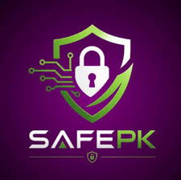

<div align="center">

  

  # SafePK
  ### A Safer Digital Pakistan

  <p align="center">
    <strong>Independent Cybersecurity Awareness, Scam Prevention & Incident Response Platform</strong>
  </p>

  <p align="center">
    <a href="https://safepk.net/"><strong>Explore Production Website »</strong></a>
  </p>

  <p align="center">
    
    
    
    
    
  </p>

</div>

---

## 🌟 Executive Summary

**SafePK** is Pakistan's dedicated independent cybersecurity education platform. It bridges the critical knowledge gap between complex cybersecurity concepts and the everyday digital reality of citizens, students, households, freelancers, and businesses in Pakistan.

The platform provides actionable, jargon-free threat guides, interactive readiness checklists, a searchable directory of official government and banking helplines, and a client-side **Incident Report Generator** that helps victims organize evidence and draft formal complaint statements for official law enforcement agencies (such as NCCIA 1799, SBP, and PTA).

> **Pure Static Architecture:** SafePK requires **zero server-side code, zero databases, and zero npm build steps** to run. You can simply double-click `index.html` in any web browser, and the complete application runs instantly with full offline resilience.

---

## 🚀 Key Platform Features

### 1. 📚 112+ Curated Scam & Threat Awareness Guides
In-depth, real-world educational articles analyzing Pakistan-specific digital threats:
- **Financial Safety:** Fake bank verification calls (spoofed caller IDs), mobile wallet fraud (Easypaisa & JazzCash PIN theft), and BISP 8171 grant scams.
- **Account Protection:** WhatsApp 6-digit verification code hijacking, Telegram task traps, and SIM replacement (SIM swap) detection.
- **E-Commerce & Delivery:** Courier address update SMS scams (Pakistan Post / TCS look-alikes), and OLX advance booking traps.
- **Device & Family Safety:** Malicious APK download warnings, fake family emergency calls, and public Wi-Fi security.

### 2. 📋 Interactive Security Readiness Checklists
Targeted, audience-specific digital hygiene checklists that calculate a live security posture score:
- **Individuals:** Essential personal account security, passkeys, and biometric hygiene.
- **Families:** Parental controls, smart home devices, and children's gaming account protection.
- **Freelancers & Remote Workers:** International payment gateways (Payoneer, Wise), client contract protection, and secure API key management.
- **Organizations:** Employee phishing defenses, access control (RBAC), and 3-2-1 backup policies.

### 3. 📝 Client-Side Incident Report Generator
A browser-based tool helping victims of cybercrime or financial fraud organize key facts into a structured, formal incident statement ready for submission to:
- **NCCIA (National Cyber Crime Investigation Agency)** — Helpline `1799`
- **State Bank of Pakistan (Banking Grievances Wing)**
- **Commercial Banks & Mobile Wallets Dispute Centers**
- **PTA (Pakistan Telecommunication Authority)** — Shortcode `9000`

> **Privacy Guarantee:** All incident report data is processed **100% inside your browser memory**. Zero sensitive personal data is transmitted, tracked, or stored on any server.

### 4. 📞 Verified Official Helpline Directory
A searchable, category-filtered directory of official, verified contact numbers, emails, and online complaint portals across:
- Law Enforcement & Regulatory Bodies (NCCIA, PTA, SBP, PKCERT, DRF)
- Commercial & Microfinance Banks in Pakistan
- Mobile Wallets & Fintechs (Easypaisa, JazzCash, Nayapay, Sadapay, UPaisa)
- Telecom Operators (Jazz, Telenor, Zong, Ufone)

---

## ⚡ Zero-Setup Quick Start

SafePK is crafted with a lightweight, browser-native philosophy. You do not need to install Node.js, run build scripts, or configure databases.

### Method 1: Direct Local Use (Double-Click)
1. Download or clone this repository:
   ```bash
   https://github.com/Kamran-Liaquat404/SafePK.git
   ```
2. Open the downloaded folder and **double-click `index.html`**.
3. That's it! The entire platform runs seamlessly in Chrome, Edge, Safari, Firefox, or Brave.

### Method 2: 1-Click Hosting (Cloudflare Pages / GitHub Pages)
Because the codebase is 100% static:
- **GitHub Pages:** Go to repository *Settings* → *Pages* → Select `main` branch → Save.
- **Cloudflare Pages:** Connect repository → Framework preset: `None` → Build command: *(leave empty)* → Output directory: `/` (or `dist` if using build.js) → Deploy.

---

## 📂 Repository File Structure

```text
safepk/
├── index.html                  # Main landing page & master entry point
├── individual.html             # Audience hub: Individuals & Security Checklist
├── family.html                 # Audience hub: Families & Security Checklist
├── freelancers.html            # Audience hub: Freelancers & Business Safety
├── organizations.html          # Audience hub: Organizations & Workplace Defense
├── donate.html                 # Voluntary community contribution page (Official QR)
├── sponsor.html                # Sponsorship & public infrastructure support
├── kamran-liaquat.html         # Founder profile & transparency notice
│
├── pages/                      # Application sub-pages
│   ├── learn.html              # Scam Awareness Library (Search & Categories)
│   ├── tools.html              # Incident Report Generator Tool
│   ├── directory.html          # Verified Pakistan Helplines Directory
│   ├── help.html               # Emergency Help & Incident Action Workflows
│   ├── reviews.html            # Verified Community Feedback & Reviews
│   ├── about.html              # Mission, principles & initiative details
│   ├── contact.html            # Official contact & communication channels
│   ├── privacy-policy.html     # Privacy Policy
│   ├── terms-of-use.html       # Terms of Use
│   └── disclaimer.html         # Non-affiliation & educational disclaimer
│
├── individual/                 # 20 standalone deep-dive articles for Individuals
├── family/                     # 20 standalone deep-dive articles for Families
├── freelancers/                # 20 standalone deep-dive articles for Freelancers
├── organizations/              # 20 standalone deep-dive articles for Organizations
├── learn/                      # 32 core threat & scam breakdown articles
│
├── css/                        # Design system & stylesheets
│   ├── style.css               # Design tokens, color palette, typography & components
│   └── responsive.css          # Mobile-first breakpoints & responsive layout rules
│
├── js/                         # Browser-native JavaScript modules
│   ├── script.js               # Modal controllers & Incident Report drafting engine
│   ├── learn.js                # Core threat topics dataset
│   ├── directory.js            # Official Pakistan helplines dataset
│   ├── data.js                 # Global static fallbacks & resources
│   ├── theme.js                # Light/Dark theme & responsive navigation controller
│   └── reviews.js              # Community feedback client engine
│
├── assets/                     # Visual assets & images
│   ├── images/
│   │   ├── safepk-logo.png     # Official SafePK brand logo
│   │   └── safepk-official-qr.svg # Official contribution QR code (Ubank / Raast)
│   └── [audience]/pictures/    # Curated, lightweight article illustrations
│
├── _redirects                  # Cloudflare Pages 301 canonical redirect rules
├── .htaccess                   # Apache server canonical rewrite rules
├── robots.txt                  # Search engine crawl directives
├── sitemap.xml                 # Canonical XML sitemap covering all 135+ pages
└── manifest.json               # Progressive Web App (PWA) manifest
```

---

## 🛡️ Privacy & Security Principles

1. **Zero Client Telemetry:** No third-party trackers, no invasive analytics, and no behavioral tracking scripts.
2. **Client-Side Privacy by Design:** The Incident Report Generator runs completely within the user's browser runtime. No user input or drafted statement is sent to any backend server.
3. **No Commercial Advertisements:** SafePK is strictly non-commercial and contains no ad networks, affiliate links, or sponsored promotional articles.

---

## ⚖️ Non-Affiliation & Legal Disclaimer

SafePK is an independent, non-governmental public cybersecurity awareness project founded by **Kamran Liaquat**. 

- SafePK is **not** affiliated with, endorsed by, or an official representative of any government agency, ministry, law enforcement agency (including NCCIA or FIA), regulator (PTA, SBP), bank, or telecom company.
- All institutional names, helpline numbers, shortcodes, and brand logos mentioned on this platform are used solely for factual identification, public education, and emergency reporting reference.

---

## 🤝 Community & Support

SafePK is sustained voluntarily to keep public cybersecurity education 100% free for every internet user in Pakistan.

- **Founder:** Kamran Liaquat
- **Official Inquiries:** [infosafepk@proton.me](mailto:infosafepk@proton.me)
- **Voluntary Contributions:** View our official [Support SafePK Page](https://safepk.net/donate.html) (Ubank / Raast QR: `FATIMA - 3839`).

---

<div align="center">
  <p>© SafePK — Dedicated to a safer, more resilient digital Pakistan.</p>
</div>
